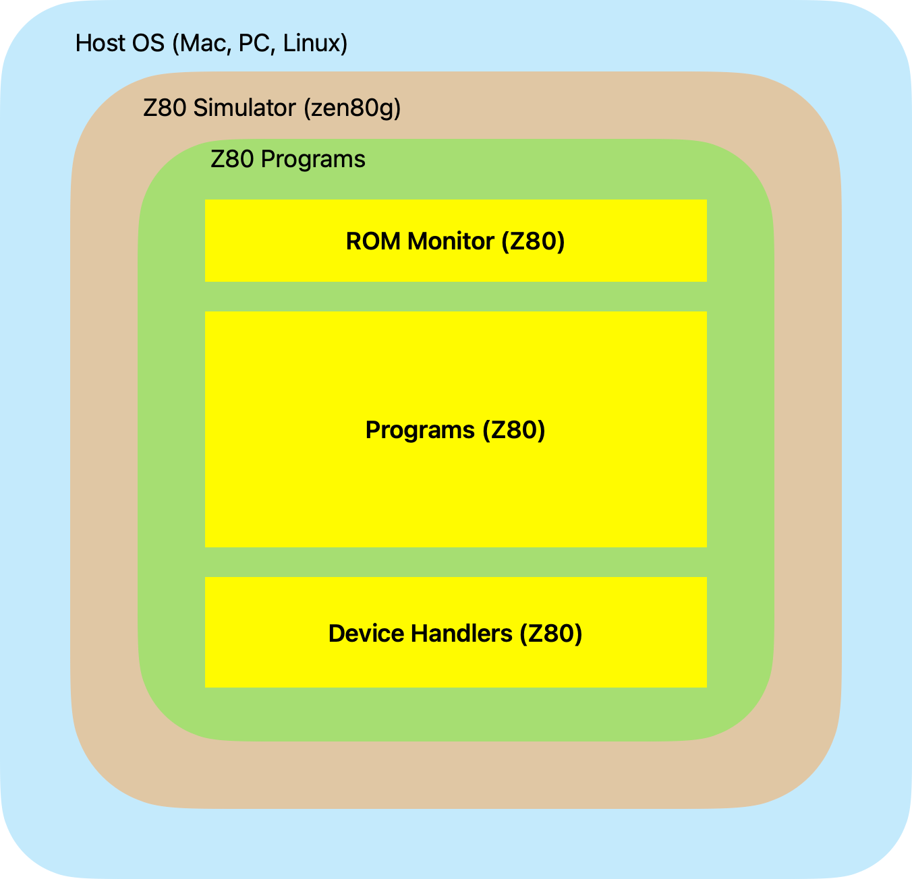
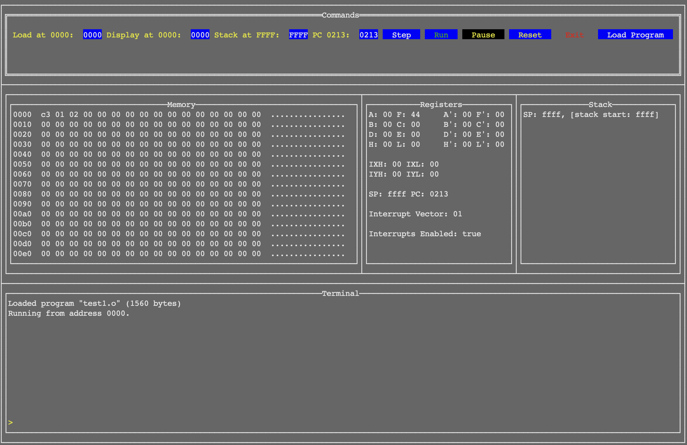
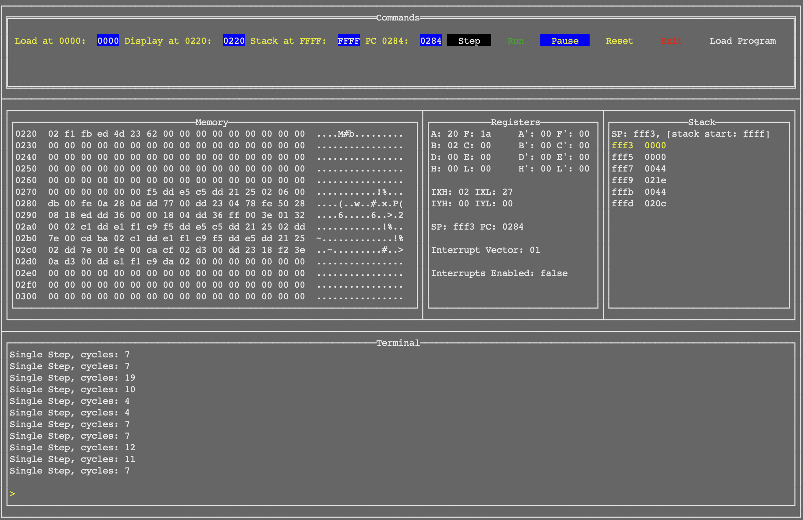

# zen80g
zen80g is a terminal-based GUI implementation of the zen80 Z80 microprocessor simulator.
## Credits
**zen80 emulator by [ha1tch](https://github.com/ha1tch/zen80)

**Z80 ROM Monitor code based on projects by [a] and [b]

**Terminal UI [tview](github.com/rivo/tview) open source code

**Z80 Assembler and Tools [z88dk](https://github.com/z88dk/z88dk)

# Project Summary
zen80g is a front-end to a Z80 8-bit mircorprocessor simulator. I'm using an excellent z80 simulator called zen80 written by [ha1tch](https://github.com/ha1tch/zen80.git), [website](https://ha1tch.github.io/zsp/projects/zen80/index.html).

Using a Z80 simulator is a nostalgic move by myself as I started my career in 1979 programming microcontrollers in Z80 assembly language and then moved on to programming Z80 based terminals by Wang Labs using PL/M-80 and assembly language. Yeah, I'm that old! Retired now, I like to play with retro tech. Go is my language of choice right now. It seems to have just the right mix of the simplicity of C and the structure of a higher level language without making things too complicated (I've used everything from Algol, CMS-2, FORTRAN, ADA, C, Pascal, Objective-C, Swift, to Java). Goroutines are especially interesting as they make it easy to implement threading.

You may notice I'm using **Simulator** instead of **Emulator**. I'm old-school, and back in the day when we were building and testing electronic systems, companies like Texas Instruments and Hewlett Packard sold expensive systems that could be used as pin-for-pin electrical signal compatible replacements for the actual microprocessor chips. These systems were what we knew as **emulators**. There were available software tools written in FORTRAN, Algol, Lisp. etc. that could provide reasonable simulation of assembled and linked object code in a hosted environemt to assist in debugging and testing before burning up a real microprocessor. These were called **Simulators**. The difference is ingrained in me, and I'm maintaining the distinction in my project.

I'm doing this for fun and to contribute to the retro computing community. Feel free to borrow and change as you wish. Comments and suggestions are always welcome. Submit an Issue in GitHub. I'm always open to collaboration with others who enjoy retro microprocessors.

# Design
Use the **Load at** field on the main screen to view or change the address for future program loads (default `0000`). Changing it does not move the program currently in memory. The **Display at** field changes the address shown in the memory view and remains independent of the program load address. The **Stack at** field changes the stack start address and updates the stack pointer. The **PC** field sets the program counter immediately. The memory and stack panes are scrollable and will shrink and expand as you resize the main window. Use the **Load Program** button to load a raw Z80 binary from a file on the host at the selected program load address. A binary can also be loaded at startup with `-program <path>`. Be sure to provide the full path, not a relative path.

### Terminal Input to Z80 Programs

Enter ordinary text in the **Terminal Input** field and press Enter to submit the complete line. The submitted line can be either a Directive to the zen80 simulator or a Command to the simulated Z80 processor (typically a small  ROM monitor program always running waiting for interrupts). The input device raises a maskable interrupt only after Enter submits the line. The Z80 program running in the simulator reads a line of characters when it receives a Mode 2 interrupt from I/O port `00` using `IN A,(0)`. Each submitted line, including an empty line, ends with line feed (`0x0A`). The Z80 interrupt handler should write (echo) the byte in A to the Terminal Output with `OUT (0),A`. Directives such as `!!run`, `!!step`, `!!reset`, and `!exit` remain simulator commands and are not queued as text to the Z80. Therefore, simulator Directives do not generate an interrupt and are not seen by the Z80. Lines beginning with '#' are passed through to the Z80 code and should be handled as Commands to a simulated monitor in the Z80. All other keystrokes are passed on to the Z80 interrupt handler when Enter is pressed. A terminal input string passed to the Z80 always ends in a newline (0x0A), so it can be used to check for end of input by the interrupt handler. A sample z80 program with interrupt handler is provided in this distribution named **test1.asm**.

Since this is a GUI-based project, the main() function will be the user presentation with a grid-style layout on the terminal so it can be run without having a desktop environment. Button widgets on the GUI will support Single-Step, Run, and other zen80 functions. A section of the grid display will provide hex and ASCII inspection of the Z80 memory. Z80 register content will be updated in real-time. Memory, Register, and Stack panes are updated every 100 milliseconds. I'm adding the ability to load assembled object code from a file directly into the Z80 memory at a specified address. I will attempt to keep this project linked to the z80 project to take advantage of any updates it provides.

Builds are included for MacOS and 32-bit and 64-bit Raspberry Pi processors.

# Development Environment
Development is in Visual Studio Code on a MacBook Air M4 running macOS Golden Gate 27.x using go 1.27.x.

Z80 assembly code is cross-compiled using the open source tool [z88dk](https://github.com/z88dk/z88dk.git). Code is composed in VSCode, assembled using z88db-z80asm from <filename>.asm into object code <filename>.o and listing <filename>.lis. The <filename>.o file is loaded into zen80g simulator and executed.

# Screenshots

# Assembling sample programs
`z88dk-z80asm -l -b -o=movedatablock.o movedatablock.asm`

The -b option tells assembler to generate plain binary output without any system headers used by specific simulators.

# Running sample programs
`zen80g -program movedatablock.o`