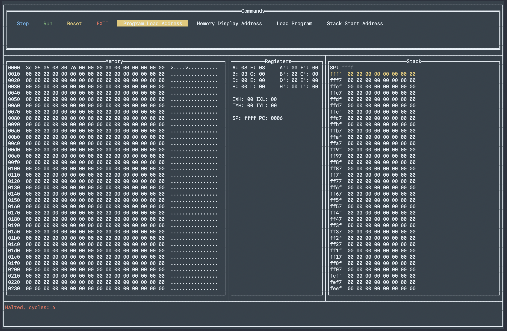

# zen80g
Terminal-based GUI implementation of the zen80 Z80 emulator
# Project Summary
zen80g is my attempt to learn the Go tview terminal UI package. I'm using an excellent z80 simulator called zen80 written by [ha1tch](https://github.com/ha1tch/zen80.git), [website](https://ha1tch.github.io/zsp/projects/zen80/index.html).

Using a Z80 emulator is a nostalgic move by myself as I started my career in 1979 programming microcontrollers in Z80 assembly language and then moved on to programming Z80 based terminals by Wang Labs using PL/M-80 and assembly language. Yeah, I'm that old! Retired now, I like to play with retro tech. Go is my language of choice right now. It seems to have just the right mix of the simplicity of C and the structure of a higher level language without making things too complicated (I've used everything from Algol, CMS-2, FORTRAN, ADA, C, Pascal, Objective-C, Swift, to Java). Goroutines are especially interesting as they make it easy to implement threading.

This is a new project, so you won't get much from it right now, but comments and suggestions are always welcome. Submit an Issue in GitHub.

# Design
Use the **Load Program** button to load a raw Z80 binary from a file at the selected program load address (default `0000`). A binary can also be loaded at startup with `-program <path>`.

Since this is a GUI-based project, the main() function will be the user presentation with a grid-style layout on the terminal so it can be run without having a desktop environment. Button widgets on the GUI will support Single-Step, Run, and other zen80 functions. A section of the grid display will provide hex and ASCII inspection of the Z80 memory. Z80 register content will be updated in real-time. I'm adding the ability to load assembled object code from a file directly into the Z80 memory at a specified address. I will attempt to keep this project linked to the z80 project to take advantage of any updates it provides.

Builds are for MacOS and 32-bit and 64-bit Raspberry Pi processors.

# Development Environment
Development is in Visual Studio Code on a MacBook Air M4 running macOS Golden Gate 27.x using go 1.27.x.

Z80 assembly code is cross-compiled using the open source tool [z88dk](https://github.com/z88dk/z88dk.git). Code is composed in VSCode, assembled using z88db-z80asm from <filename>.asm into object code <filename>.o and listing <filename>.lis. The <filename>.o file is loaded into zen80g simulator and executed.

# Screenshots
